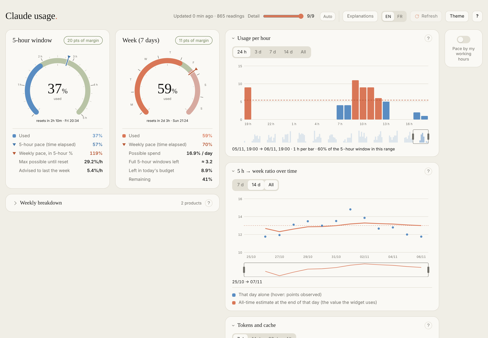
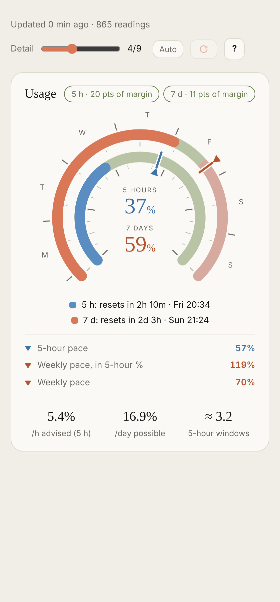
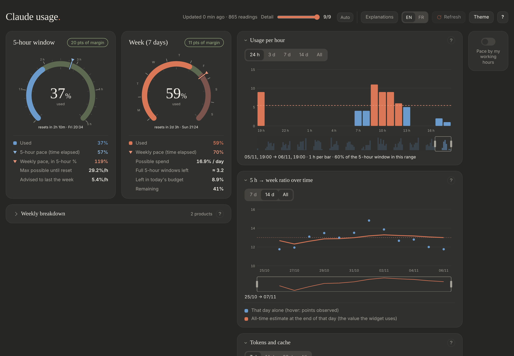

# Claude Usage Tracker

[English](README.md)

Enregistre ton quota Claude **sur 5 heures** et **sur 7 jours** (% utilisé + heures de reset) dans un fichier CSV et l'affiche sous forme de jauges, avec des indicateurs de rythme, aux couleurs de Claude. Tout tourne en local sur ta machine.



| Fenêtre étroite (cran 4) | Sombre |
|---|---|
|  |  |

> **Non officiel.** Utilise un endpoint Anthropic non documenté (`/api/oauth/usage`) qui peut changer ou disparaître sans préavis.

## Démarrage rapide

Rien à compiler : les lanceurs sont déjà dans le dépôt.

1. Aie **Python 3.8+** (bibliothèque standard uniquement, rien à installer) et **Claude Code connecté** avec ton abonnement Claude, sur la même machine.
2. Télécharge le projet (page **Releases**, ou *Code → Download ZIP*, ou `git clone`) et décompresse-le **en entier**.
3. Lance :

| OS | Lancer |
|---|---|
| Windows | double-clic sur **`claude-usage-tracker.exe`** (ou `run.bat`) |
| Linux | **`claude-usage-tracker`** (ou `app/run.sh` ; après un téléchargement ZIP, lance une fois `chmod +x claude-usage-tracker app/run.sh`) |
| Tous | `python app/run.py` |

> Le `.exe` / programme Linux n'est qu'un lanceur : il démarre `run.bat` / `run.sh` du dossier `app/` voisin, donc il ne fonctionne pas seul. Copie le dossier entier, pas juste le binaire.

Tes relevés sont stockés dans le dossier `app/data/`, à côté du code (voir [Où vont tes données](#où-vont-tes-données)).

Au premier lancement, on choisit la langue (English / Français), puis un menu à flèches s'affiche, avec une courte explication sous chaque entrée :

- **Faire un relevé maintenant** – un relevé manuel, enregistré dans le CSV.
- **Ouvrir le widget** – démarre le serveur local et ouvre les jauges dans le navigateur.
- **Lancer / Arrêter le serveur du widget** – l'entrée suit l'état réel : « Lancer » quand le serveur est arrêté, « Arrêter » quand il tourne.
- **Relevés automatiques…** – installer ou retirer le poller de fond, qui fait des relevés tout seul, plus vite quand ton quota bouge et plus lentement sinon (voir [Fonctionnement](#fonctionnement)). Pas d'intervalle à choisir. Option pour lancer aussi le serveur du widget à l'ouverture de session / au démarrage. Ou rien d'automatique : tu rafraîchis à la main (bouton du widget, ou menu).
- **État** – dernier relevé, état du poller (avec l'heure du prochain relevé), état du serveur.
- **Configuration rapide**, **Lancer les tests**, **Language / Langue**, **Quitter**.

Au premier lancement, une **Configuration rapide** passe avant le menu : langue, vérification que Claude Code est connecté (sinon elle dit de taper `/login` dans Claude Code), premier relevé, relevés automatiques, serveur du widget à l'ouverture de session, raccourci sur le Bureau, ouverture du widget. Chaque étape est une question oui/non avec la réponse conseillée sur **Entrée** ; rien n'est installé sans réponse, et le récapitulatif dit ce qui a été mis en place, où sont les données et comment tout enlever. Elle se relance depuis le menu ou avec `run.py --setup` (`--yes` prend toutes les réponses conseillées sans rien demander). Le menu est regroupé (Voir · Relevés · Réglages · Maintenance), avec une ligne d'état en haut (relevé auto, serveur, dernier relevé).

### Le widget

Jauges de la fenêtre 5 heures et de la semaine, avec des graduations de temps à l'extérieur des anneaux (tous les quarts d'heure, heures numérotées, pour la fenêtre 5 h ; minuits locaux et initiales des jours pour la semaine) et les graduations de % à l'intérieur. Une **répartition hebdo** par produit (chaque barre est découpée par jour, voir plus bas), et sur le côté un interrupteur **Rythme selon mes heures de travail** (coupé par défaut : le rythme semaine suit le temps du calendrier) ; activé, un **curseur d'heures par jour** apparaît (1–24 h) : le rythme semaine compte alors ces heures de travail (à partir de ta première requête du jour, 08:00 par défaut) et le rythme horaire conseillé est calculé dessus. Le bouton **?** (en haut à droite) ouvre toutes les équations avec tes valeurs dans un panneau latéral. L'en-tête indique quand aura lieu le prochain relevé automatique (« prochain dans … »).

- **Curseur Détail** (en-tête) : six crans, de deux fines barres (1) à tout (6). Chaque panneau reste à chaque cran, juste comprimé : 1 les deux barres ; 2 + % et repère de rythme, et chaque autre panneau sur une ligne (barre des types de tokens avec le total en millions, % du ratio 5 h → semaine, bande de 24 cases pour les dernières 24 h, barre des produits) ; 3 + heures de reset et un second chiffre par ligne (taux de cache, ratio du jour, heure de pic) ; 4 les deux anneaux dans un cadran, courbe du ratio et barres par heure ; 5 cadrans complets avec petits graphiques et cartes ; 6 tout (sélecteurs de plage, tableaux, tokens par jour). **Auto** (par défaut) choisit le cran d'après la largeur de la fenêtre. **Explications** est un septième cran à part : le cran 6 plus une courte note sous chaque panneau ; le **?** de chaque panneau affiche ou masque sa propre note. **Panneaux** (bouton de l'en-tête) choisit quels panneaux existent, indépendamment du cran, et se partage comme les autres réglages.
- **Mise en page** : une colonne sur écran étroit, graphiques côte à côte à partir de 900 px, deux colonnes à partir de 1300 px, trois à partir de 1750 px. Au toucher : zones de 44 px, un appui montre la valeur d'une barre ou d'un point, glisser et pincer sur les graphiques.
- **Thème** (en-tête) : préréglages (Claude, contraste élevé, daltonien, monochrome), tes couleurs pour les deux anneaux et les zones dans / hors budget, clair et sombre séparément, une police système, export / import en texte.
- **Installable** : Chrome / Edge proposent « Installer l'application » (fenêtre et icône à part) ; il s'ouvre aussi sur `http://claude.localhost:8765/`.
- Les réglages (cran, explications, heures de travail, langue, thème) sont gardés dans `app/data/config.json` via le serveur : tous les navigateurs et clients voient les mêmes.

Dans la répartition, la barre de chaque produit a un segment par jour local, de la même couleur, avec de fins séparateurs, et le nom du jour écrit dedans (nom complet, puis abréviations plus courtes, puis une lettre, puis rien, selon la place). Survole un segment pour voir sa date et ses points. Chaque produit est mesuré séparément : le segment d'un jour correspond à ce que **ce** produit a consommé ce jour-là (d'après les parts par produit enregistrées dans `breakdown.csv` à chaque changement), donc un jour où tu n'as utilisé que Code n'apparaît que dans la barre Code. L'usage d'avant le début du suivi par produit cette semaine forme un seul segment « Avant » (exact au total, mais pas découpé par jour).

Trois panneaux d'historique repliés se trouvent sous la répartition :

- **Usage par heure** : barres de la fenêtre de 5 h consommée à chaque heure (1 h, 3 h, 6 h ou 1 jour par barre selon la plage), face au rythme horaire en pointillés qui tient ton budget du jour.
- **Ratio 5 h → semaine dans le temps** : combien de % de la semaine coûte une fenêtre de 5 h pleine, jour par jour (points) et en estimation cumulée, celle que le widget utilise (ligne).
- **Tokens et cache** : les quatre types de tokens (entrée fraîche, écriture de cache, lecture de cache, sortie) avec leur nombre, leur part des tokens, leur prix relatif et leur part du coût, l'économie apportée par le cache et une vue par jour. Le coût est en équivalents de tokens d'entrée normaux (lecture de cache × 0,1, écriture × 1,25 ou × 2, sortie × 5), pas en dollars ; la pondération réelle du quota n'est pas publiée.

Les deux premiers ont un sélecteur de plage et une petite vue d'ensemble en dessous, comme une courbe de bourse : glisse la fenêtre pour la déplacer, tire ses bords pour zoomer, clique à côté pour y sauter. La plage est mémorisée dans le navigateur. Le panneau des tokens a ses propres boutons 7 j / 14 j / 30 j / Tout.

Les chiffres de tokens viennent des transcripts de Claude Code (`~/.claude/projects/**/*.jsonl`, ou `CLAUDE_PROJECTS_DIR`), lus de façon incrémentale par `transcripts.py` : seuls les nombres d'usage, le modèle, l'heure et l'identifiant du message sont lus dans chaque ligne, jamais le texte des conversations. Les chats et Cowork consomment aussi le quota sans laisser de transcript : les tokens ne couvrent que Claude Code.

### Raccourcis en ligne de commande

```
python app/run.py read                      un relevé
python app/run.py start                     lance le serveur du widget (arrière-plan, sans navigateur)
python app/run.py open                      lance le serveur si besoin et ouvre le widget
python app/run.py stop                      arrête le serveur
python app/run.py status
python app/run.py install [--with-server]   lance le poller de fond à l'ouverture de session (et tout de suite)
python app/run.py uninstall                 le retire (arrête aussi un poller en cours)
python app/run.py tests
python app/run.py shortcut [--remove]       raccourci Bureau / menu qui ouvre directement le widget
python app/run.py hub --url URL --token T   envoie aussi chaque relevé à un hub (voir plus bas) ; --off pour arrêter
python app/run.py --setup [--yes]           relance la configuration rapide (--yes : réponses conseillées, sans question)
python app/run.py --lang fr <command>       force la langue
```

### API de lecture, VS Code, autres appareils

- **API** (mêmes données pour tous les clients, jamais le jeton Claude) : `GET /api/v1/latest`, `/api/v1/history?since=ISO`, `/api/v1/tokens?since=AAAA-MM-JJ`, `/api/v1/model[?hours=N]` (valeurs des cadrans, limites et rythmes calculés par le serveur, prêts à dessiner), `GET`/`POST /api/v1/config` (réglages partagés, validés). `latest.json` porte `"schema": 1` ; `app/schema/latest.v1.json` est l'exemple de référence.
- **VS Code** : `app/vscode/` est une extension avec un indicateur dans la barre d'état (`▰▰▱ 42 % · ▰▱▱ 18 %`, infobulle, couleurs selon les seuils) et une vue latérale dessinée avec les composants du widget, au cran qui va avec sa largeur. Voir [app/vscode/README.md](app/vscode/README.md).
- **Hub** (machine toujours allumée : NAS, petit serveur) : y lancer `server.py --bind 0.0.0.0 --token-file data/api_token` (ou le `app/Dockerfile`) ; sur le PC, `run.py hub --url http://hub:8765 --token <le jeton du hub>`. Le PC continue de faire les relevés et pousse chacun : le jeton Claude ne le quitte jamais. Sur le hub, chaque requête demande le jeton d'API (`Authorization: Bearer`, ou ouvrir `/?token=…` une fois dans le navigateur). Y accéder par Tailscale / WireGuard (`tailscale serve` fournit le HTTPS, nécessaire pour installer l'application sur un téléphone) plutôt que depuis Internet ; les noms d'hôte en plus vont dans `allowed_hosts` de `config.json` ou `--allow-host`.

## Lanceurs et icône

En plus de `app/run.bat` / `app/run.sh`, la racine du projet contient deux petits programmes déjà compilés qui ne font que démarrer ces scripts dans un terminal (même menu, mêmes arguments) :

| OS | Programme | Icône |
|---|---|---|
| Windows | `claude-usage-tracker.exe` (double-clic, ou épingle-le à la barre des tâches) | intégrée au .exe |
| Linux | `claude-usage-tracker` (binaire statique) + une entrée de menu avec `make desktop` | via l'entrée de menu |

Le widget a aussi une icône d'onglet (`app/web/favicon.svg`). Logo : deux anneaux, orange = semaine, bleu = fenêtre 5 heures. Le menu du terminal en affiche une version en pixel art.

### Les compiler toi-même (make)

Utile seulement pour les reconstruire ou les modifier. À lancer depuis le dossier `app/` (`cd app`). Prérequis : Python 3 et `pip install ziglang` (le compilateur Zig empaqueté pour pip ; il compile les deux programmes depuis n'importe quel OS, rien d'autre à installer). Les icônes demandent aussi `pip install pillow`.

```
make            explique seulement les cibles (rien n'est compilé)
make all        compile les deux programmes (à côté du README)
make windows    claude-usage-tracker.exe (avec l'icône, via assets/app.rc)
make linux      claude-usage-tracker
make desktop    ajoute « Claude Usage Tracker » au menu des applications Linux
make icons      régénère assets/ et web/favicon.* depuis tools/make_icons.py
make clean      supprime les deux programmes compilés
python tools/build.py [windows|linux|icons|desktop|clean]    pareil sans make (par ex. sous Windows)
```

Fonctionnement : `app/tools/launcher.c` cherche `run.bat` (Windows) ou `run.sh` (Linux) dans le dossier `app/` voisin et le démarre. `app/tools/make_icons.py` dessine le logo une seule fois et écrit les fichiers SVG, PNG et ICO. Les binaires fournis ne sont pas signés : Windows SmartScreen peut afficher un avertissement la première fois ; recompile-les depuis les sources si tu préfères.

## Où vont tes données

Tout reste dans le dossier `app/data/` à côté du code (ignoré par git, créé automatiquement au premier relevé ; rien n'est écrit ailleurs) :

| Fichier | Contenu |
|---|---|
| `usage.csv` | une ligne par relevé : heure, % 5 heures, % semaine, heures de reset |
| `latest.json` / `latest.js` | dernier état + historique récent (seulement les relevés où les valeurs ont changé, plus le dernier), lus par le widget |
| `breakdown.csv` | parts hebdo par produit, une ligne par produit à chaque changement ; sert à découper les barres de répartition par jour |
| `tokens.csv` | compteurs de tokens par heure, modèle et type d'agent (principal / sous-agent), lus dans les transcripts de Claude Code (nombres seulement) |
| `transcripts_state.json` | où le lecteur de transcripts s'est arrêté dans chaque fichier (les fichiers sont identifiés par un hachage, jamais par leur nom), les identifiants de messages déjà comptés, et ses compteurs horaires |
| `poller.json` | état du poller : heure du prochain relevé, palier actuel |
| `poller.lock` | verrou pour qu'un seul poller tourne à la fois |
| `last_response.json` | réponse brute de l'API au dernier relevé (débogage) |
| `tracker.log` | journal des relevés en arrière-plan (statut, Retry-After, échecs d'affilée) |
| `errors.json` | les 30 derniers relevés en échec, avec tous les détails ; le bandeau rouge du widget les ouvre (**Détails**) |
| `config.json` | langue du menu, configuration faite, réglages du widget (cran, explications, heures de travail, thème), adresse du hub |
| `hub_token` / `api_token` | seulement avec un hub : le jeton d'API du tracker (droits 0600 ; ce n'est pas le jeton Claude) |
| `server.log` | sortie du serveur du widget (Linux) |

Hors de `app/data/` : le raccourci « Claude Usage » si tu l'as créé (`run.py shortcut --remove`), la tâche planifiée si tu en installes une (Planificateur de tâches Windows, ou service systemd utilisateur / ligne crontab sous Linux ; le menu la retire), et les dossiers `__pycache__` de Python. Le fichier d'identifiants de Claude Code est seulement **lu**, jamais copié. Un relevé demande Claude Code connecté ; sinon le menu t'indique que les identifiants sont introuvables.

## Fonctionnement

- `claude_usage.py` lit ton jeton OAuth Claude Code dans `~/.claude/.credentials.json` (Windows : `%USERPROFILE%\.claude\.credentials.json` ; respecte `CLAUDE_CONFIG_DIR`, ou définis `CLAUDE_USAGE_TOKEN`), interroge l'endpoint d'usage et ajoute une ligne à `data/usage.csv`. Il écrit aussi `data/latest.json` / `latest.js` pour le widget.
- Le jeton d'accès dure environ 8 heures et seul Claude Code le renouvelle : lance `claude` une fois dans un terminal (l'app Claude desktop ne semble pas réécrire ce fichier). Une fois son `expiresAt` passé, aucune requête n'est envoyée (elle prendrait un HTTP 401) ; le poller surveille le fichier et relève dès qu'il change.
- `server.py` sert le widget sur `http://127.0.0.1:8765` (local uniquement ; contrôles Host/Origin contre le DNS rebinding) et permet au bouton **Relever** de déclencher un relevé.
- `poller.py` est le poller adaptatif derrière les relevés automatiques : une boucle qui tourne en continu, pas un intervalle fixe. Après un relevé où le % 5 heures ou hebdo a changé, le suivant a lieu 30 s plus tard ; chaque relevé sans changement monte d'un palier (1 min, 3 min, 5 min, 7 min, puis 10 min, où il reste). Après un HTTP 429 (limite de débit), il attend 2 min, ou le `Retry-After` de l'API s'il est plus long, sans changer de palier. Les autres erreurs comptent comme « pas de changement ». Un seul poller tourne à la fois.
- Lancement en arrière-plan : sous Windows, la tâche planifiée « Claude Usage Tracker » démarre le poller à l'ouverture de session (et dès l'installation) et le relance s'il plante ; sous Linux, c'est le service systemd utilisateur `claude-usage-tracker.service` (`Restart=on-failure`), ou une ligne `@reboot` de crontab sans systemd (le poller est alors lancé tout de suite).
- Le widget fonctionne aussi ouvert comme simple fichier (`app/web/index.html`), mais ne peut alors pas se rafraîchir seul.

Le ratio semaine / 5 heures affiché dans le widget est estimé à partir de tes relevés consécutifs (10 % tant qu'il n'y a pas assez de données).

## Comment les chiffres sont calculés

Le bouton **?** du widget ouvre le panneau **Comment c'est calculé** qui montre chaque équation avec tes valeurs actuelles. Même contenu ici. Notation : *u5* / *u7* = % utilisé dans la fenêtre 5 heures / la semaine (donnés par Claude), *h* = le curseur d'heures par jour.

| Quoi | Équation |
|---|---|
| Rythme 5 h (repère bleu) | `(5 h − temps restant) / 5 h × 100` – vrai temps écoulé |
| Début de ta journée de travail | premier relevé du jour où la consommation a augmenté (ta première requête), sinon 08:00 |
| Rythme semaine (repère orange, anneau semaine) | `heures de travail écoulées cette semaine / heures de travail de la semaine × 100` – un jour = *h* heures à partir de l'heure de début ; à 24 h c'est le temps calendaire |
| Coût d'une fenêtre 5 h, *r* | % de la semaine consommé par 100 % d'une fenêtre 5 h, estimé sur tes relevés consécutifs (10 % par défaut) |
| Semaine utilisée en début de journée, *u0* | % hebdo au dernier relevé avant minuit local (le plus ancien s'il n'y en a pas ; 0 si la semaine a été remise à zéro) |
| Jours jusqu'au reset, *D* | `(reset hebdo − aujourd'hui 00:00) / 24 h` |
| **Budget du jour** *B* (« dépense possible / jour ») | `(100 − u0) / D` |
| Limite hebdo à cet instant, *L7* (frontière vert/rouge de l'anneau semaine) | `u0 + B` |
| Reste du budget du jour | `max(0, L7 − u7)` |
| Limite 5 h, *L5* (repère orange et frontière vert/rouge de l'anneau 5 h) | `u5 + (L7 − u7) × 100 / r` (peut dépasser 100 % quand le budget du jour couvre plus d'une fenêtre de 5 h) |
| **Conseillé par heure** (% 5 h /h) | `B / h × 100 / r` |
| Maximum possible jusqu'au reset | `(100 − u5) / heures restantes de la fenêtre` |
| Fenêtres 5 h pleines restantes | `(100 − u7) / r` |
| Répartition par produit | `part du produit × u7 / 100` points du quota hebdo, répartis par jour d'après les parts enregistrées dans `breakdown.csv` et le % de la semaine au fil du temps |
| Pastille « en avance / marge » | `utilisé − rythme` ; au-delà de ±5 points : en avance / marge |

**Ce que change le curseur :** le rythme semaine (heures de travail au lieu du temps calendaire) et le rythme horaire conseillé. Le rythme 5 h est du vrai temps, et les zones vert/rouge viennent du budget du jour, qui ne dépend pas du curseur.

## Structure du projet

```
README.md  README.fr.md  LICENSE
claude-usage-tracker.exe    lanceur Windows (double-clic)
claude-usage-tracker        lanceur Linux
app/                        tout le reste
  run.py  run.bat  run.sh   point d'entrée (menu)
  launcher/                 code du menu et traductions (strings.py)
  claude_usage.py           lit le quota, écrit data/
  poller.py                 poller adaptatif (relevés en arrière-plan)
  transcripts.py            compteurs de tokens locaux d'après les transcripts de Claude Code
  server.py                 serveur local du widget et API de lecture (/api/v1)
  model.py  settings.py     le modèle de rythme calculé côté serveur, réglages partagés
  hub.py  Dockerfile        hub : relevés poussés par un PC, jeton d'API
  schema/                   exemple de latest.json (contrat de données)
  vscode/                   extension VS Code
  web/                      le widget (HTML, CSS, JS ; EN/FR)
  windows/  linux/          scripts d'installation/désinstallation du planificateur
  tools/  assets/  Makefile source C des lanceurs, scripts de build, icônes
  docs/                     captures du README
  data/                     tes relevés (ignoré par git, jamais commité)
```

## Confidentialité

- Aucune donnée ne quitte ta machine, hormis la requête vers l'API d'Anthropic avec ton propre jeton.
- Le jeton est lu à l'exécution, jamais copié ni journalisé. `app/data/` et les identifiants sont dans `.gitignore`.
- Le serveur n'écoute que sur `127.0.0.1`, sauf si tu lances un hub avec `--bind`, qui exige alors un jeton d'API à chaque requête.
- Les transcripts de Claude Code contiennent tes conversations. `transcripts.py` n'y lit que des nombres de tokens, le modèle, l'heure, l'identifiant du message et l'indicateur de sous-agent, et n'écrit que des compteurs et des identifiants de messages (des chaînes aléatoires de l'API) ; jamais le texte, ni aucun nom de projet ou de dossier (les fichiers de transcripts sont identifiés par un hachage). Chaque message n'est compté qu'une fois, même quand une session reprise ou un fichier de sous-agent le répète.

## Remarques

- macOS : les scripts sont du Python/shell standard et peuvent fonctionner, mais l'installation du planificateur n'est pas testée (utilise cron à la main).
- Si tu avais installé les relevés automatiques avec l'ancienne organisation (avant le dossier `app/`), refais **Relevés automatiques** une fois dans le menu : l'ancienne tâche pointe vers l'ancien emplacement.
- Si tu as installé les relevés automatiques avec la v1.0.0 (intervalle fixe), refais **Relevés automatiques** une fois dans le menu pour passer au poller.
- Non affilié à Anthropic.

## Licence

MIT – voir [LICENSE](LICENSE).
