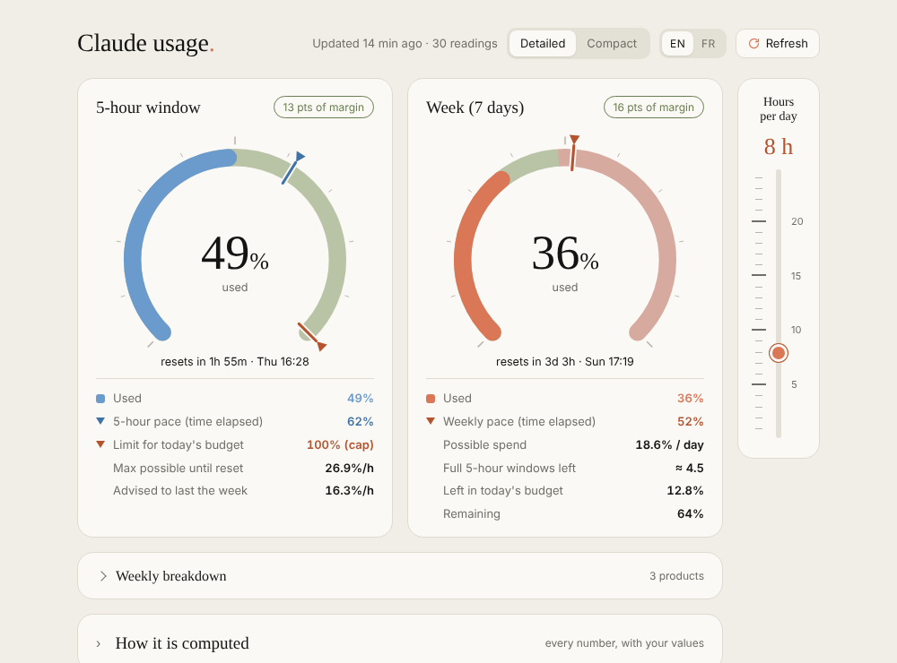
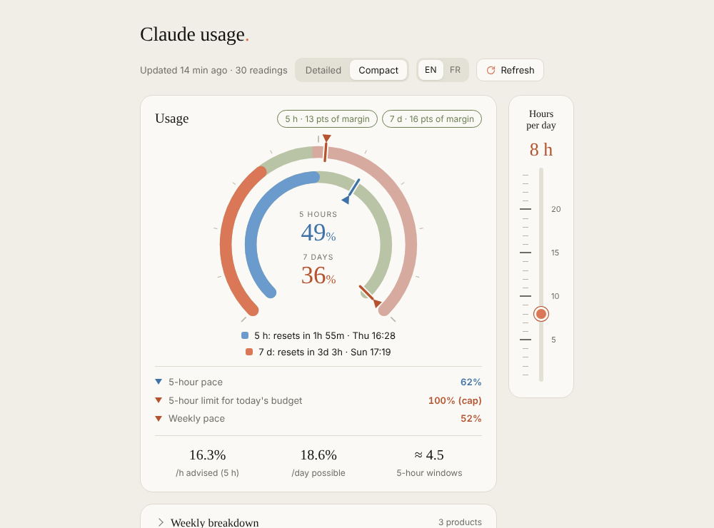
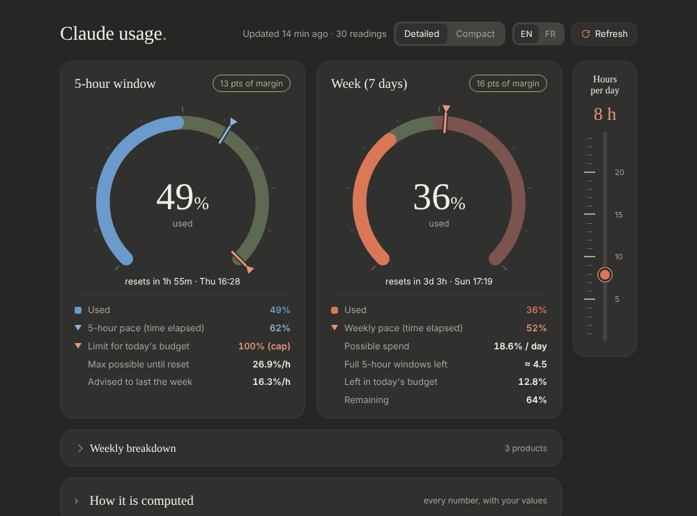

# Claude Usage Tracker

[Français](README.fr.md)

Logs your Claude **5-hour** and **7-day** quota (% used + reset times) to a CSV file and shows it as gauges, with pacing indicators, in Claude's colours. Everything runs locally on your machine.



| Compact | Dark |
|---|---|
|  |  |

> **Unofficial.** It uses an undocumented Anthropic endpoint (`/api/oauth/usage`) that may change or disappear without notice.

## Quick start

You do not need to build anything: the launchers are already in the repository.

1. Have **Python 3.8+** (standard library only, nothing to install) and **Claude Code signed in** with your Claude subscription on the same machine.
2. Download the project (**Releases** page, or *Code → Download ZIP*, or `git clone`) and unpack it **as a whole folder**.
3. Start it:

| OS | Start |
|---|---|
| Windows | double-click **`claude-usage-tracker.exe`** (or `app\run.bat`) |
| Linux | **`claude-usage-tracker`** (or `app/run.sh`; after a ZIP download run `chmod +x claude-usage-tracker app/run.sh` once) |
| Any | `python app/run.py` |

> The `.exe` / Linux program is only a launcher: it starts `run.bat` / `run.sh` from the `app/` folder next to it, so it does not work alone. Copy the whole folder, not just the binary.

Your readings are stored in the `app/data/` folder next to the code (see [Where your data goes](#where-your-data-goes)).

The first launch asks for a language (English / Français), then shows an arrow-key menu with a short explanation under each entry:

- **Take a reading now** – one manual reading, saved to the CSV.
- **Open the widget** – starts the local server and opens the gauges in your browser.
- **Start / Stop the widget server** – the entry follows the real state: it offers "Start" when the server is off and "Stop" when it is running.
- **Automatic readings** – install or remove the background poller, which takes readings by itself, faster while your quota is moving and slower when it is not (see [How it works](#how-it-works)). No interval to choose. Optionally also start the widget server at login/boot. Or skip it entirely and refresh by hand (button in the widget, or the menu).
- **Status** – last reading, poller state (with the time of the next reading), server state.
- **Run tests**, **Language**, **Quit**.

### The widget

Gauges for the 5-hour window and the week, a compact/detailed switch, a collapsed per-product **Weekly breakdown** (each bar is split by day, see below), and an **hours-per-day slider** on the side (1–24 h, long marks every 5 h): tell it how many hours a day you really use Claude and the weekly pace counts those working hours (from your first request of the day, 08:00 by default) and the advised hourly pace is computed over them. A collapsed panel lists every equation (see below). The header shows when the next automatic reading is due ("next in …").

In the breakdown, each product's bar has one segment per local day, all in the same colour with thin separators, and the day name written inside (full name, then shorter abbreviations, then one letter, then nothing, depending on the room). Hover a segment for its date and points. Each product is measured on its own: a day's segment is how much **that** product rose that day (from the per-product shares recorded in `breakdown.csv` at each change), so a Code-only day only shows up in the Code bar. Usage from before the per-product tracking started this week forms a single "Earlier" segment (exact in total, not split by day).

### Command-line shortcuts

```
python app/run.py read                      one reading
python app/run.py start                     start the widget server (background, no browser)
python app/run.py open                      start the server if needed and open the widget
python app/run.py stop                      stop the server
python app/run.py status
python app/run.py install [--with-server]   start the background poller at logon (and now)
python app/run.py uninstall                 remove it (also stops a running poller)
python app/run.py tests
python app/run.py --lang fr <command>       force the language
```

## Launchers and icon

Besides `app/run.bat` / `app/run.sh`, the project root holds two tiny prebuilt programs that do nothing but start those scripts in a terminal (same menu, same arguments):

| OS | Program | Icon |
|---|---|---|
| Windows | `claude-usage-tracker.exe` (double-click, or pin it to the taskbar) | embedded in the .exe |
| Linux | `claude-usage-tracker` (static binary) + a menu entry with `make desktop` | from the menu entry |

The widget also has a browser-tab icon (`app/web/favicon.svg`). Logo: two rings, orange = week, blue = 5-hour window. The terminal menu shows a pixel-art version of it.

### Building them yourself (make)

You only need this to rebuild or change them. Run it from the `app/` folder (`cd app`). Requirements: Python 3 and `pip install ziglang` (the Zig compiler packaged for pip; it cross-compiles both programs from any OS, nothing else to install). Icons also need `pip install pillow`.

```
make            only explains the targets (nothing is built)
make all        build both programs (next to the README)
make windows    claude-usage-tracker.exe (with the icon, via assets/app.rc)
make linux      claude-usage-tracker
make desktop    add "Claude Usage Tracker" to the Linux applications menu
make icons      regenerate assets/ and web/favicon.* from tools/make_icons.py
make clean      delete the two built programs
python tools/build.py [windows|linux|icons|desktop|clean]    same thing without make (e.g. on Windows)
```

How it works: `app/tools/launcher.c` finds `run.bat` (Windows) or `run.sh` (Linux) in the `app/` folder next to itself and starts it. `app/tools/make_icons.py` draws the logo once and writes the SVG, PNG and ICO files. The prebuilt binaries are unsigned, so Windows SmartScreen may warn you the first time; rebuild them from source if you prefer.

## Where your data goes

Everything stays in the `app/data/` folder next to the code (git-ignored, created automatically by the first reading; nothing is written anywhere else):

| File | What |
|---|---|
| `usage.csv` | one line per reading: time, 5-hour %, week %, reset times |
| `latest.json` / `latest.js` | latest state + recent history (only readings where values changed, plus the last one), read by the widget |
| `breakdown.csv` | per-product weekly shares, one line per product each time they change; used to split the breakdown bars by day |
| `poller.json` | poller state: time of the next reading, current step |
| `poller.lock` | lock so that only one poller runs at a time |
| `last_response.json` | raw API answer of the last reading (debugging) |
| `tracker.log` | log of the background readings (status, Retry-After, failures in a row) |
| `errors.json` | the last 30 failed readings with full detail; the widget's red banner opens it (**Details**) |
| `config.json` | your menu language |
| `server.log` | widget server output (Linux) |

Outside `app/data/`: the scheduled task if you set one up (Windows Task Scheduler, or a systemd user service / crontab line on Linux; the menu removes it), and Python's `__pycache__` folders. The Claude Code credentials file is only **read**, never copied. A reading needs Claude Code signed in; otherwise the menu tells you the credentials were not found.

## How it works

- `claude_usage.py` reads your Claude Code OAuth token from `~/.claude/.credentials.json` (Windows: `%USERPROFILE%\.claude\.credentials.json`; honours `CLAUDE_CONFIG_DIR`, or set `CLAUDE_USAGE_TOKEN`), calls the usage endpoint, and appends a row to `data/usage.csv`. It also writes `data/latest.json` / `latest.js` for the widget.
- The access token lasts about 8 hours and only Claude Code renews it: run `claude` once in a terminal (the Claude desktop app does not seem to rewrite this file). Once its `expiresAt` is past, no request is sent (it would only get HTTP 401); the poller watches the file and reads again as soon as it changes.
- `server.py` serves the widget on `http://127.0.0.1:8765` (local only; Host/Origin checks against DNS rebinding) and lets the **Refresh** button trigger a reading.
- `poller.py` is the adaptive poller behind the automatic readings: a long-running loop, not a fixed interval. After a reading where the 5-hour or weekly % changed, the next one comes 30 s later; each reading without change climbs one step (1 min, 3 min, 5 min, 7 min, then 10 min, where it stays). After an HTTP 429 (rate limited) it waits 2 min, or the API's `Retry-After` if longer, without moving on the ladder. Other errors count as "no change". Only one poller runs at a time.
- Background start: on Windows the "Claude Usage Tracker" scheduled task starts the poller at logon (and right at install) and restarts it if it crashes; on Linux it is the systemd user service `claude-usage-tracker.service` (`Restart=on-failure`), or an `@reboot` crontab line without systemd (the poller is then started immediately).
- The widget also works opened as a plain file (`app/web/index.html`) but then cannot refresh by itself.

The weekly-vs-5-hour ratio shown in the widget is estimated from your own consecutive readings (10 % until enough data exists).

## How the numbers are computed

The widget has a collapsed **How it is computed** panel that shows each equation with your current values. Same content here. Notation: *u5* / *u7* = % used in the 5-hour window / the week (as reported), *h* = the hours-per-day slider.

| What | Equation |
|---|---|
| 5-hour pace (blue marker) | `(5 h − time left) / 5 h × 100` – real elapsed time |
| Start of your work day | first reading of the day where usage rose (your first request), else 08:00 |
| Weekly pace (orange marker, week ring) | `working hours elapsed this week / working hours in the week × 100` – a day is *h* hours from the start time; at 24 h it is plain calendar time |
| Cost of a 5-hour window, *r* | % of the week consumed per 100 % of a 5-hour window, estimated from your consecutive readings (default 10 %) |
| Week used at start of today, *u0* | weekly % at the last reading before local midnight (oldest reading if none; 0 if the week reset since) |
| Days until reset, *D* | `(weekly reset − today 00:00) / 24 h` |
| **Daily budget** *B* ("possible spend / day") | `(100 − u0) / D` |
| Weekly limit now, *L7* (green/red boundary of the week ring) | `u0 + B` |
| Left in today's budget | `max(0, L7 − u7)` |
| 5-hour limit, *L5* (orange marker and green/red boundary of the 5-hour ring) | `u5 + (L7 − u7) × 100 / r` (may exceed 100 % when today's budget covers more than one 5-hour window) |
| **Advised per hour** (5-hour %/h) | `B / h × 100 / r` |
| Max possible until reset | `(100 − u5) / hours left in the window` |
| Full 5-hour windows left | `(100 − u7) / r` |
| Per-product breakdown | `product share × u7 / 100` points of the weekly quota, split per day from the shares recorded in `breakdown.csv` and the week's % over time |
| "Ahead / margin" pill | `used − pace`; beyond ±5 points it reads ahead / margin |

**What the slider changes:** the weekly pace (working hours instead of calendar time) and the advised hourly pace. The 5-hour pace is real time, and the green/red zones come from the daily budget, which does not depend on the slider.

## Project layout

```
README.md  README.fr.md  LICENSE
claude-usage-tracker.exe    Windows launcher (double-click)
claude-usage-tracker        Linux launcher
app/                        everything else
  run.py  run.bat  run.sh   entry point (menu)
  launcher/                 menu code and translations (strings.py)
  claude_usage.py           reads the quota, writes data/
  poller.py                 adaptive poller (background readings)
  server.py                 local widget server
  web/                      the widget (HTML, CSS, JS; EN/FR)
  windows/  linux/          scheduler install/uninstall scripts
  tools/  assets/  Makefile launchers' C source, build scripts, icons
  docs/                     README screenshots
  data/                     your readings (git-ignored, never committed)
```

## Privacy

- No data leaves your machine except the request to Anthropic's API with your own token.
- The token is read at run time and never copied or logged. `app/data/` and credentials are in `.gitignore`.
- The server only listens on `127.0.0.1`.

## Notes

- macOS: the scripts are plain Python/shell and may work, but the scheduler setup is untested (use cron manually).
- If you set up automatic readings with an older layout (before the `app/` folder existed), open the menu and redo **Automatic readings** once: the old task points to the old location.
- If you installed automatic readings with v1.0.0 (fixed interval), open the menu and redo **Automatic readings** once to switch to the poller.
- Not affiliated with Anthropic.

## Licence

MIT – see [LICENSE](LICENSE).
