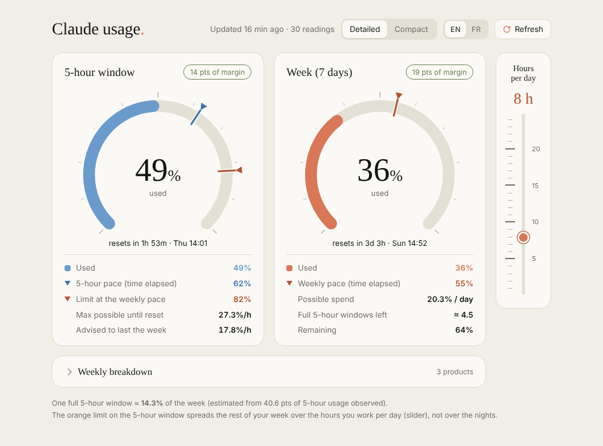
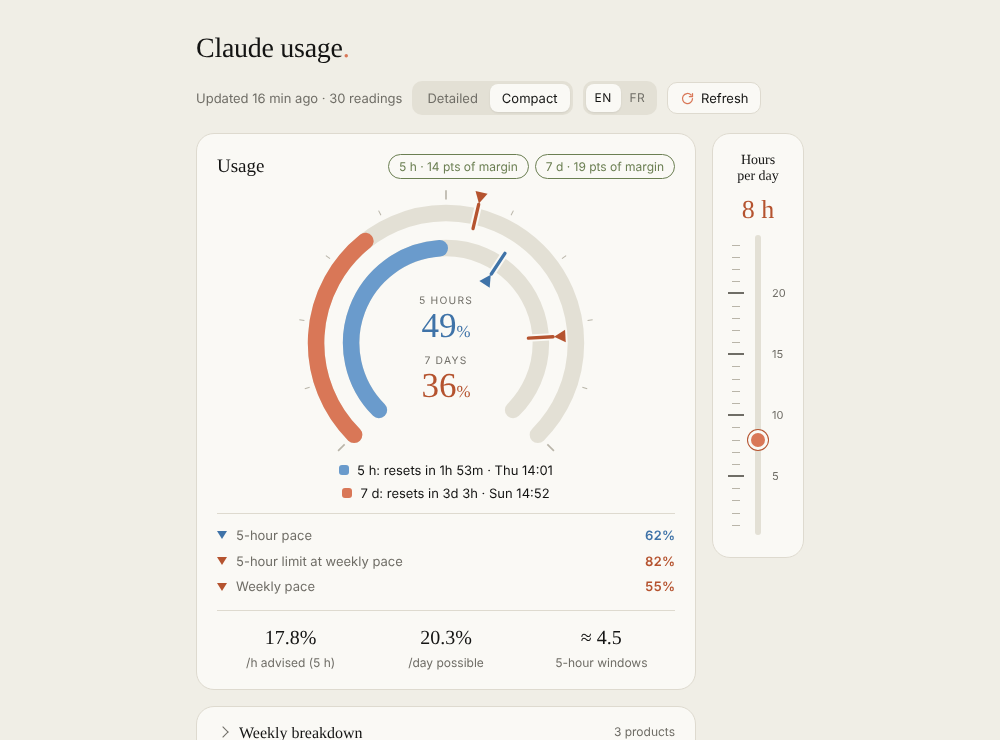
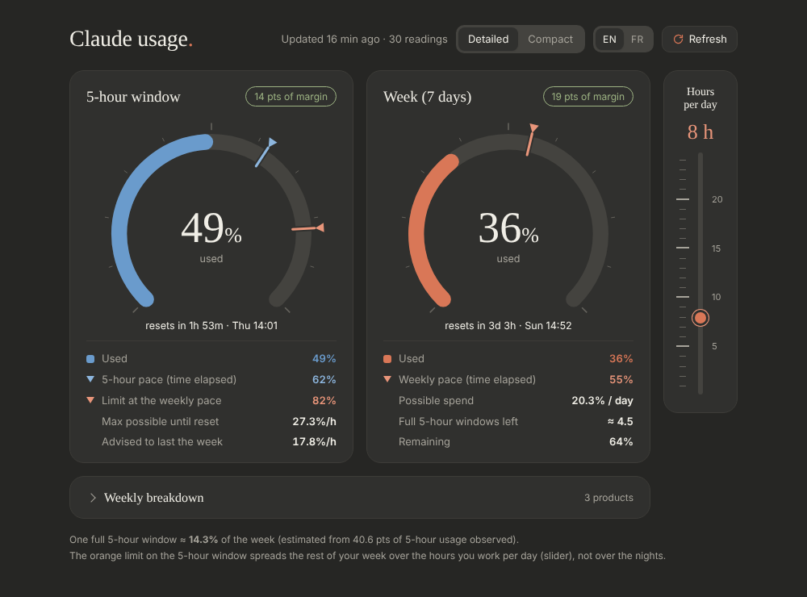

# Claude Usage Tracker

[Français](README.fr.md)

Logs your Claude **5-hour** and **7-day** quota (% used + reset times) to a CSV file and shows it as gauges, with pacing indicators, in Claude's colours. Everything runs locally on your machine.



| Compact | Dark |
|---|---|
|  |  |

> **Unofficial.** It uses an undocumented Anthropic endpoint (`/api/oauth/usage`) that may change or disappear without notice.

## Quick start

Requirements: Python 3.8+ (standard library only, nothing to install) and Claude Code signed in on the same machine.

| OS | Start |
|---|---|
| Windows | double-click `run.bat` (or `run.bat` in a terminal) |
| Linux | `./run.sh` (first time: `chmod +x run.sh`) |
| Any | `python run.py` |

The first launch asks for a language (English / Français), then shows an arrow-key menu with a short explanation under each entry:

- **Take a reading now** – one manual reading, saved to the CSV.
- **Open the widget** – starts the local server and opens the gauges in your browser.
- **Start / Stop the widget server** – the entry follows the real state: it offers "Start" when the server is off and "Stop" when it is running.
- **Automatic readings** – install, change or remove the background task. Default: every **10 minutes**; pick a preset or type any number of minutes. Optionally also start the widget server at login/boot. Or skip it entirely and refresh by hand (button in the widget, or the menu).
- **Status** – last reading, scheduler state, server state.
- **Run tests**, **Language**, **Quit**.

### The widget

Gauges for the 5-hour window and the week, a compact/detailed switch, a collapsed per-product breakdown, and an **hours-per-day slider** on the side (1–24 h, long marks every 5 h): tell it how many hours a day you really use Claude and the advised hourly pace and the 5-hour limit are recomputed over those hours instead of over the nights too.

### Command-line shortcuts

```
python run.py read                      one reading
python run.py start                     start the widget server (background, no browser)
python run.py open                      start the server if needed and open the widget
python run.py stop                      stop the server
python run.py status
python run.py install --minutes 10 [--with-server]
python run.py uninstall
python run.py tests
python run.py --lang fr <command>       force the language
```

## How it works

- `claude_usage.py` reads your Claude Code OAuth token from `~/.claude/.credentials.json` (Windows: `%USERPROFILE%\.claude\.credentials.json`; honours `CLAUDE_CONFIG_DIR`, or set `CLAUDE_USAGE_TOKEN`), calls the usage endpoint, and appends a row to `data/usage.csv`. It also writes `data/latest.json` / `latest.js` for the widget.
- `server.py` serves the widget on `http://127.0.0.1:8765` (local only; Host/Origin checks against DNS rebinding) and lets the **Refresh** button trigger a reading.
- Scheduling: Windows Task Scheduler, or a systemd user timer on Linux (cron fallback).
- The widget also works opened as a plain file (`web/index.html`) but then cannot refresh by itself.

The weekly-vs-5-hour ratio shown in the widget is estimated from your own consecutive readings (10 % until enough data exists).

## Project layout

```
run.py / run.bat / run.sh   entry point (menu)
launcher/                   menu code and translations (strings.py)
claude_usage.py             reads the quota, writes data/
server.py                   local widget server
web/                        the widget (HTML, CSS, JS; EN/FR)
windows/  linux/            scheduler install/uninstall scripts
data/                       your readings (git-ignored, never committed)
```

## Privacy

- No data leaves your machine except the request to Anthropic's API with your own token.
- The token is read at run time and never copied or logged. `data/` and credentials are in `.gitignore`.
- The server only listens on `127.0.0.1`.

## Notes

- macOS: the scripts are plain Python/shell and may work, but the scheduler setup is untested (use cron manually).
- Existing scheduled tasks created by earlier versions keep working.
- Not affiliated with Anthropic.

## Licence

MIT – see [LICENSE](LICENSE).
